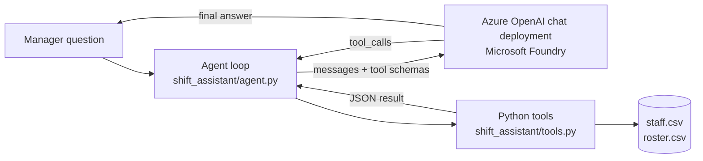

# Foundry Shift Assistant


A small **AI agent** that answers a restaurant manager's rostering questions by **calling Python tools** over a roster CSV:

- *"Who can cover the close on Saturday?"*
- *"Can Sam close on Wednesday?"*
- *"What's the labour cost for the week, plus 12% on-costs?"*
- *"Who still has hours left this week?"*

The model (an Azure OpenAI chat deployment, e.g. in a Microsoft Foundry project) decides **which tool to call**. The tools apply the business rules in plain Python, and the model explains the result. Names, hours and dollar figures always come from code, never from the model's guesswork.

> **Demo project with sample data.** Everything in `data/` (staff, pay rates, roster) is **fictional sample data** written for this demo. Labour costs are base-rate estimates (hours × hourly rate) and do **not** model award penalty rates. This is a learning and portfolio project built alongside my AI-103 preparation, not a production rostering system.

## Why I built this

I was a Business Manager at Grill'd and Mad Mex, where rostering, labour cost and finding cover for a close shift were weekly problems. This project turns those questions into an agent that uses tools, the core pattern behind agents in Microsoft Foundry.

## How it works



1. The agent sends the question plus five **tool schemas** (OpenAI function-calling format) to the chat deployment.
2. If the model replies with `tool_calls`, the agent runs each tool in Python and sends the JSON result back as a `tool` message.
3. This repeats (up to 6 steps) until the model replies with a normal answer.
4. Tool errors (e.g. a misspelt day) go back to the model as `{"error": ...}` so it can correct itself.

### Tools

| Tool | What it does | Rules applied |
|------|--------------|---------------|
| `get_roster` | Shifts for a day or the whole week | |
| `find_cover` | Who can cover a slot on a day, fewest hours first | close-trained for close, open-trained for open, available that day, not already rostered that day, stays within max weekly hours |
| `check_assignment` | Can this person work this slot? If not, why not | same rules as `find_cover` |
| `estimate_labour_cost` | Hours × base hourly rate per day and for the week, with an optional flat on-cost % | base rates only, no penalty rates |
| `staff_hours` | Rostered hours vs max hours per person | |

The close-shift rule is the same one used in my [Hospitality Roster App](https://sivakowshik.github.io/projects/hospitality-roster-app.html): staff who can't close are refused for close shifts.

## Project structure

```
foundry-shift-assistant/
├── shift_assistant/
│   ├── data.py      # load staff + roster CSVs (standard library only)
│   ├── tools.py     # the 5 tools, their JSON schemas, and run_tool()
│   ├── agent.py     # tool-calling agent loop
│   └── config.py    # settings from .env, Azure OpenAI v1 client
├── data/            # SAMPLE staff and roster CSVs (fictional)
├── tests/           # offline tests: rules + agent loop with a mocked LLM
├── ask.py           # ask a question (needs Azure)
├── offline_demo.py  # run the tools on the sample data (no Azure needed)
├── requirements.txt
└── .env.example     # copy to .env, never commit secrets
```

## Setup

```bash
git clone https://github.com/sivakowshik/foundry-shift-assistant.git
cd foundry-shift-assistant
python3 -m venv .venv
source .venv/bin/activate        # Windows: .venv\Scripts\activate
pip install -r requirements.txt
```

### Try it without Azure

```bash
python offline_demo.py   # runs the tools on the sample data
pytest -q                # 15 offline tests, the LLM is mocked
```

### Run the agent with Azure OpenAI / Microsoft Foundry

1. In Microsoft Foundry (or Azure OpenAI), deploy a chat model that supports tool calling, e.g. `gpt-4o-mini`.
2. Copy the settings file and fill in your endpoint, key and deployment name:

   ```bash
   cp .env.example .env
   ```

   `AZURE_OPENAI_BASE_URL` is your resource's v1 endpoint, e.g. `https://<your-resource>.openai.azure.com/openai/v1/`.

3. Ask questions:

   ```bash
   python ask.py "Who can cover the close on Saturday?"
   python ask.py --show-tools "What's the labour cost this week with 12% on-costs?"
   python ask.py            # interactive mode
   ```

`--show-tools` prints every tool call and its result, so you can see exactly where each fact came from.

## Tests

All tests run offline with no keys:

- `tests/test_tools.py`: close rule, availability, double booking, max hours, cover ranking, labour-cost maths, error handling.
- `tests/test_agent.py`: the agent loop with a **fake LLM client** that returns scripted `tool_calls`. Checks that tool results are sent back correctly, parallel tool calls work, errors reach the model, and the step limit stops loops.

## Security notes

- Secrets live in `.env`, which is git-ignored. Only `.env.example` (placeholders) is committed.
- This demo uses an API key for simplicity. For production, use **Microsoft Entra ID** (keyless) authentication instead.

## Roadmap

- [ ] Port the same tools to **Microsoft Foundry Agent Service** (hosted agent with function tools)
- [ ] Shift-swap tool that applies the close-trained rule to swaps
- [ ] Read the roster from the Hospitality Roster App instead of CSV
- [ ] Configurable penalty rates per day instead of base rates only
- [ ] Simple web UI

## Author

**Siva Kowshik Sripathi Panditharadyula**, AI Engineer (Azure OpenAI · RAG · Agents · Python), Melbourne
[Portfolio](https://sivakowshik.github.io) · [GitHub](https://github.com/sivakowshik) · [LinkedIn](https://www.linkedin.com/in/siva-kowshik-sripathi-panditharadyula-241713150) · kowsik.king451@gmail.com
